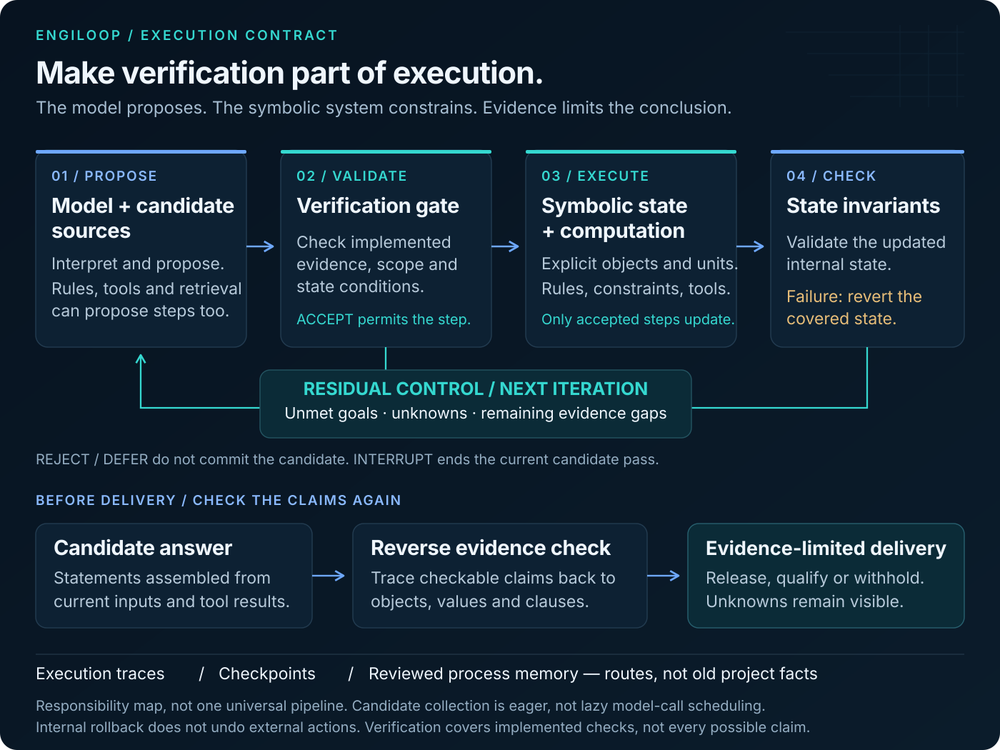
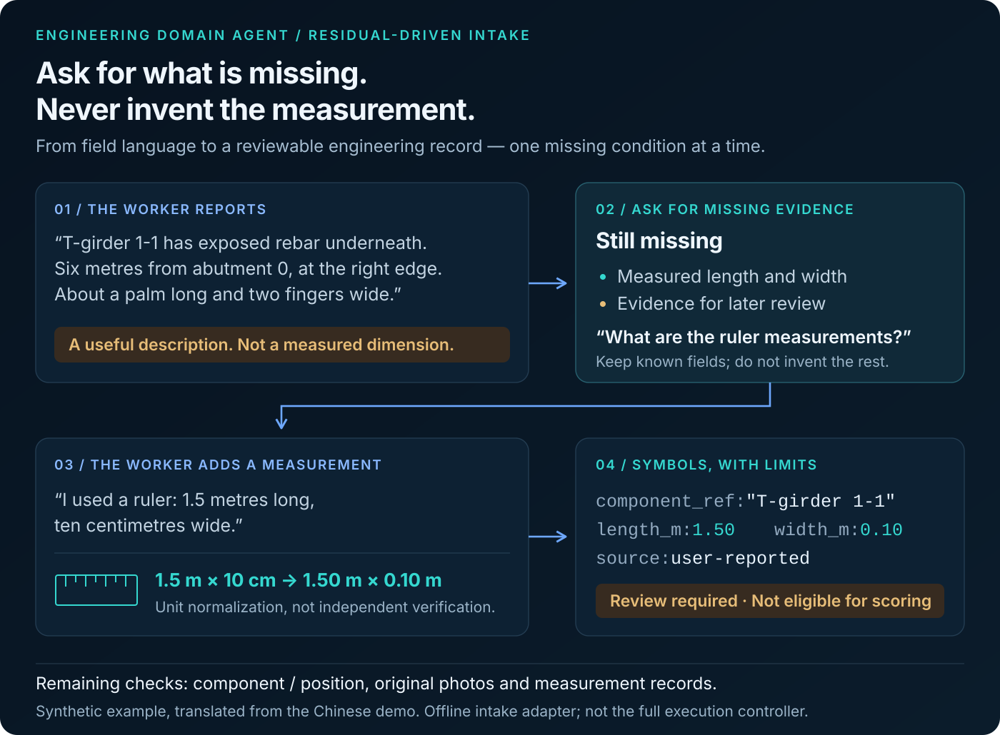

[English](README.md) · [简体中文](README.zh-CN.md)


# EngiLoop

### Neuro-Symbolic Agents for Evidence-Grounded Engineering

### Make verification part of execution.

[](https://github.com/1105216375-alt/engiloop-agent/actions/workflows/tests.yml) [](LICENSE) [](pyproject.toml)

**Models propose. Symbolic mechanisms constrain execution. Evidence limits what can be concluded.**

A neuro-symbolic reference implementation extracted from a bridge-inspection agent: structured intake, residual-driven reasoning, reverse evidence verification, governed memory, bounded computation, and checkpoint recovery. It includes the execution kernel, domain adapters, eight offline examples, and counterexample tests that inspect the final result—not just the logs.

[Quick start](#quick-start) · [Architecture](docs/architecture.en.md) · [Runnable mechanisms](#eight-mechanisms-you-can-run) · [Security](SECURITY.md) · [Contributing](CONTRIBUTING.md)

> **Release scope:** reusable mechanisms, not a complete production application or a certified engineering assessment service. Private archives, standards corpora, corporate databases, model credentials, and the product UI are excluded. Extracted code, public adaptations, and extension points are distinguished in the [source map](docs/source-map.md) and [release boundaries](docs/release-boundaries.md) (Chinese).

## Intelligence needs an execution contract

An engineering agent must do more than produce a convincing answer. It must preserve the distinction between a suggestion, a calculation, an observation, and an authorized conclusion.

This repository makes that distinction operational:

- A model response is a **candidate**, not an engineering fact.
- A retrieved passage is a **possible source**, not proof of applicability.
- A remembered procedure can suggest a **route**, not supply facts about a new asset.
- A successful calculation is an **intermediate result**, not automatic permission to issue a report.



*The diagram shows responsibilities and control boundaries, not a promise that every request runs every module. The current kernel collects proposer candidates before checking them; it is not a lazy “call the model only if cheaper tools fail” scheduler.*

| Responsibility | What it contributes | Boundary |
|---|---|---|
| **Model / semantic layer** | Interpret language, suggest fields and actions, organize a response | Cannot turn missing measurements into facts or grant itself execution authority |
| **Symbolic layer** | Explicit objects, units, constraints, formulas, state, and provenance | A well-formed field does not establish a real-world fact |
| **Verification layer** | Check implemented object, number, citation, scope, and state conditions | Agreement from another model is not a substitute for evidence |
| **Residual control** | Keep unmet requirements visible; guide the next question or bounded answer | Unknowns remain unknown until the relevant evidence is supplied |
| **Governed memory** | Reuse approved process patterns to influence candidate order | Current evidence and the current verifier still apply |

Read the [English architecture guide](docs/architecture.en.md) for actual execution order, interruption behavior, rollback scope, and external side effects.

## From field language to a checkable record

“About a palm long” is useful context. It is not a measurement. The intake example tracks what is missing, asks for the missing information, and normalizes supplied measurements without pretending that the site condition has been independently confirmed.



*Synthetic example, not a product screenshot. The runnable intake example uses a rule-based Chinese parser; the English labels explain its behavior. Unit normalization does not verify component identity or photographic evidence.*

```python
from engineering_agent.nlp import MeasurementIntakeSession

session = MeasurementIntakeSession()
session.ingest("1-1号T梁梁底有一处锈胀露筋。")
session.ingest("距0号台6米、距右侧0米，一巴掌长、两指宽。")
record = session.ingest("尺子量过：长1.5米，宽十厘米。")

print(record["symbol"])
print(record["residual"]["verification_gaps"])
# Measurements are normalized; identity/photo review conditions remain.
```

These inputs describe reinforcement exposure on a T-girder, then supply location and an informal size estimate, and finally a measured length of 1.5 m and width of 10 cm. The parser does not convert the informal estimate into an exact number.

An LLM can be connected explicitly with `compile_intake(..., llm_call=your_adapter)`. Its output still passes through structure and constraint checks. The offline examples do not make model calls or require API keys. Provider costs, data-transfer authorization, and service security belong to the integrating application.

## Eight mechanisms you can run

| Mechanism | Observable behavior | Example module |
|---|---|---|
| **Neuro-symbolic intake** | Preserve negation and task constraints; distinguish estimates from measurements; normalize supplied units | [`semantic_intake`](examples/semantic_intake.py) |
| **Report-to-structure parsing** | Supported DOCX tables become defect records with document hash, table/row/column, and source text | [`report_intake`](examples/report_intake.py) |
| **Residual reasoning** | Removing scoring, load-test, or maintenance evidence restricts the answer; no calibrated life model means no invented remaining-life estimate | [`residual_reasoning`](examples/residual_reasoning.py) |
| **Reverse RAG + graph retrieval** | Wrong-object numbers and nonexistent citations are removed or withheld; irrelevant citations receive review warnings | [`reverse_verification`](examples/reverse_verification.py) |
| **Governed process memory** | Unapproved patterns cannot be used; approval changes subsequent candidate order without copying another bridge's facts | [`reviewed_memory`](examples/reviewed_memory.py) |
| **Tool results in calculations** | Synthetic deduction input 20 → 60 changes the component score 80 → 40 and the selected-scope result; reported values remain separate | [`engineering_scoring`](examples/engineering_scoring.py) |
| **Validation + recovery** | Rejected steps do not commit; injected faults trigger covered state rollback; SQLite checkpoints support approvals and whole-task retries | [`checkpoints_and_rollback`](examples/checkpoints_and_rollback.py) |
| **Native execution traces** | Real tool-call boundaries produce OTLP JSON; absent model calls do not become fabricated model spans | [`native_trace`](examples/native_trace.py) |

### Reverse verification changes the delivered answer

Forward retrieval finds candidate evidence. Reverse verification checks covered claims in a proposed answer against the current tool results and the explicitly supplied clause index.

For example, a value belonging to a bearing cannot justify a claim about a main girder merely because that number appears somewhere in the results. A nonexistent clause is removed; an existing but irrelevant clause is flagged for review. Invalid verification results or an empty valid body are withheld instead of falling back to the unverified original text.

This is an executable error-control mechanism, **not** a complete proof of arbitrary natural-language reasoning. Soft warnings and hard blocks are intentionally different. The public adapter rejects an empty clause index rather than pretending that full citation verification took place.

## Quick start

Requires **Python 3.10+**. The examples run offline; dependency installation needs package-index access.

```bash
git clone https://github.com/1105216375-alt/engiloop-agent.git
cd engiloop-agent
python -m venv .venv
source .venv/bin/activate
python -m pip install -e '.[dev]'
python -m pytest
python -m examples.all_mechanisms
```

On Windows PowerShell, activate with `.venv\Scripts\Activate.ps1` instead of `source`.

The repository is now called EngiLoop (previously Engineering Domain Agent). The Python distribution remains `engineering-domain-agent`, and the import package remains `engineering_agent` for compatibility.

Run an individual mechanism or audit the release:

```bash
python -m examples.semantic_intake
python -m examples.reverse_verification
python -m examples.reviewed_memory
python -m examples.checkpoints_and_rollback
python tools/check_release.py
```

`all_mechanisms` is a collection of independent synthetic acceptance examples, not a single real bridge archive passing through every production workflow. `native_trace` demonstrates an actual intake → retrieval → output-checking call chain. No example sends records to a model service.

## What is reusable

The reusable pattern is **structured input → explicit gaps → candidates → checks → controlled state updates → output verification**.

To adapt it, supply the domain vocabulary, object identities, evidence types, versioned rules and formulas, applicability conditions, and approval boundaries. Then test missing evidence, wrong-object values, incompatible memory, and injected execution failures against the final state and delivered answer.

Road maintenance and equipment inspection are potential adaptations—not completed integrations in this release. Law and mathematics require their own authoritative sources, proof obligations, and dedicated validators. This repository does not include the separate Lean experiments.

## Engineering boundaries

- **No “zero hallucination” or safety-certification claim.** Covered checks do not validate every causal statement or prove real-world conditions.
- **No automatic engineering sign-off.** Condition screening is not a load-capacity, traffic-safety, remaining-life, or repair-cost conclusion. The public release has no calibrated cost model and keeps that gap explicit.
- **No hidden score adjustment.** Reported and computed values remain separate. The public scoring entry point only produces bounded component snapshots and never publishes a formal whole-bridge grade. Legacy low-level aggregators have upstream preconditions; their empty-input defaults must not be used for sign-off.
- **No automatic reversal of external actions.** Internal rollback does not undo a sent work order, network request, or model charge. Reading a checkpoint is not exact mid-step resumption.
- **No model-cost claim from candidate priority.** Proposers are called to collect candidates before verification. Ordering alone does not establish token savings.
- **No sandbox or universal proof claim.** The calculator uses a bounded AST interpreter instead of Python `eval`, but registered Python callables remain trusted code. Some checkers, distillation components, and domain contracts are extension points rather than completed capabilities.

## Documentation

| Guide | Language |
|---|---|
| [Architecture, execution order, and boundaries](docs/architecture.en.md) | English · [中文](docs/architecture.md) |
| [Neuro-symbolic conversion](docs/neural-symbolic.md) | Chinese |
| [Reverse RAG and graph-backed checks](docs/reverse-rag.md) | Chinese |
| [Residual reasoning and governed memory](docs/residual-and-memory.md) | Chinese |
| [Scoring and source-value governance](docs/scoring-and-provenance.md) | Chinese |
| [Checkpoints and recovery](docs/checkpoints-and-recovery.md) | Chinese |
| [Native execution traces](docs/native-trace.md) | Chinese |
| [Bounded arithmetic](docs/safe-arithmetic.md) | Chinese |
| [Source map](docs/source-map.md) · [Public adaptations](docs/public-adaptations.md) · [Release boundaries](docs/release-boundaries.md) | Chinese |
| [Security](SECURITY.md) · [Contribution guide](CONTRIBUTING.md) | English |

## License

The current project is offered under the [GNU Affero General Public License, version 3 only](LICENSE) (AGPL-3.0-only). Commercial use is permitted subject to its terms; if you modify the covered program and users interact with it over a network, section 13 requires an opportunity for those users to obtain the corresponding source. See [NOTICE](NOTICE) for attribution. Dependencies and third-party components retain their own licenses.

Earlier public versions, through commit [`dd539c8`](https://github.com/1105216375-alt/engiloop-agent/tree/dd539c86303c47f77a3e4ecbd0082a93b7edb105), were offered under Apache-2.0; that grant remains in effect for those versions. A copy of the [previous license](LICENSES/Apache-2.0.txt) is retained. The license change does not revoke rights already granted under Apache-2.0.
