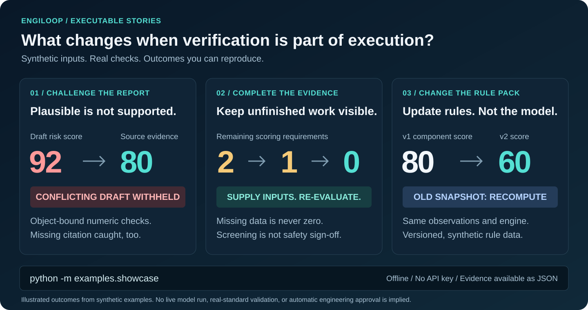
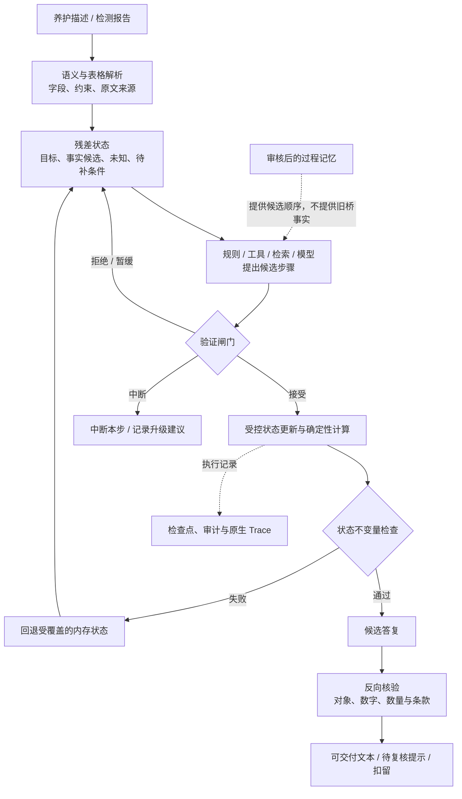

[English](README.md) · 简体中文


# EngiLoop

### 以神经—符号执行构建可验证的领域智能体

**模型提出候选，领域引擎负责计算，证据核验把守交付。**

EngiLoop 将通用大模型与本地符号知识、确定性领域引擎、残差驱动推理和独立证据核验结合，让领域智能体的处理过程可检查、可质疑、可追溯。

代码抽取自“桥梁医生”，当前按 **AGPL-3.0-only** 开放。先看三个能亲自运行的演示：缺证据、用错数、规则变化，确实会改变系统能交付什么。模型接入是可选项；离线演示使用合成输入与脚本候选，不冒充真实模型调用。

[快速开始](#快速开始) · [三个演示](#三个演示看懂机制) · [架构](docs/architecture.md) · [运行说明](docs/showcase.md)

> 这是机制级参考实现，不是原生产产品的完整镜像或可直接签发的工程评定服务。真实档案、规范全文、企业数据库、模型账号和产品 UI 不随仓库分发；原实现抽取、新增适配与未实现接口明确区分。见[来源映射](docs/source-map.md)和[发布边界](docs/release-boundaries.md)。

## 三个演示，看懂机制



### 01 · 报告写得像真的，不代表证据支持

合成 Word 草稿写“主梁风险评分 92”，另附的独立证据为 80，还引用了不存在的条款。系统保留表格来源定位，反查数字与条款，**扣留错误草稿**。再试一次“拿支座的 30 分证明主梁”，同样被拦截。依据证据生成的替换句还要再核验。

```bash
python -m examples.showcase report
```

这里展示的是**反向 RAG 如何改变输出**，不是多展示几条检索结果。风险评分不是技术状况得分；替换句来自显式模板，不冒称模型自主纠错。

### 02 · 证据没补齐，就不假装任务已经完成

同一个合成会话先缺两个评分，再补一个，最后补齐：**评分缺口 2 → 1 → 0**。每次重跑真实推理代码，在条件不足时不输出交叉风险判断，缺失值不补零。条件补齐后也只给技术状况筛查，不外推承载能力或通行安全。

```bash
python -m examples.showcase residual
```

同一命令另附两个独立示例：口语录入的缺失字段 **4 → 2 → 0**，但“一巴掌长”不当量测；故障注入展示核验拒绝不提交、非法状态更新后回退。三者分开标注，不假装是一份真实档案贯通了全部流程。

### 03 · 更新规则配置，不用重新训练模型

输入记录、模型与评分公式不变，只切换合成规则包：示例扣分 **20 → 40**，构件分 **80 → 60**，指定范围分 **81.46 → 64.39**。规则摘要变化后旧快照不能继续复用，重算结果绑定新规则版本。

```bash
python -m examples.showcase rules
```

可以修改 [v2 规则数据](examples/fixtures/rules_v2.json) 再运行。数字来自自拟演示映射，不是真实规范；展示的是显式规则切换、结果绑定与复算，不是自动识别新规范或生产级缓存失效平台。

三个演示都不需要 API 密钥。添加 `--json` 可看原始证据、核验问题、缺口及状态明细；这不是现场准确率评估。

### 为什么验证必须影响执行

[Axiom 宣布](https://axiommath.ai/research/the-enormous-theorem-formalized/)用 Lean 形式化有限单群分类定理；该定理的原始证明文献约有 15,000 页。这也引出工程智能体的一个问题：**答案被使用之前，由谁来检查？**

Lean 检查形式化数学命题的证明；EngiLoop 则对已实现范围内的工程主张开展规则计算与证据一致性核验。两者的验证对象和保证强度不同，不能画等号；公开演示使用合成输入，也不包含完整规范库。共同启示是：**生成，不等于可信；验证，必须能够改变交付结果。**

### 核心不是多加一个模型，而是改变采信路径

模型输出不直接成为工程事实；检索命中不直接成为适用依据；记忆命中不直接成为本轮证据；计算成功也不自动意味着可以发布结论。



这是职责图，不表示每个请求都会执行全部模块。当前内核先收集各 proposer 的候选，再逐个校验；**不是**按此图实现“前面的工具失败后才调用模型”的省 token 调度器。执行顺序、回滚范围与对外副作用见[组合说明](docs/architecture.md)。

### 可以亲自运行的机制

| 机制 | 可观察的行为 | 演示 |
|---|---|---|
| 神经—符号输入 | 口语、否定、任务约束进入结构；“一巴掌”不冒充量测，补充长度宽度后归一单位 | `examples.semantic_intake` |
| 报告进入符号结构 | DOCX 支持表格 → 病害记录 + 文档哈希、表/行/列和原文 | `examples.report_intake` |
| 残差推理 | 撤去评分/承载/维修证据，最终答复受限；无寿命模型时保留缺口 | `examples.residual_reasoning` |
| RAG 反向核验与图谱 | 错构件数值、不存在的条款被删除或扣留；不相关条款产生复核警告 | `examples.reverse_verification` |
| 受审核记忆 | 未批准不可用；批准后实际调整后续候选顺序，不复制来源桥的数值与病害 | `examples.reviewed_memory` |
| 工具计算进入结果 | 合成 DP 20→60，实际构件分 80→40，指定范围分随之变化；报告原值保留 | `examples.engineering_scoring` |
| 校验、回退、检查点 | 拒绝不提交；故障注入触发状态回退；SQLite 检查点、审批、整任务重试 | `examples.checkpoints_and_rollback` |
| 原生执行轨迹 | 实际工具调用边界生成 OTLP JSON；没有模型调用就不伪造模型 span | `examples.native_trace` |

公开版计算器使用[有界 AST 解释器](docs/safe-arithmetic.md)，不对用户表达式执行 Python `eval`。注册的 Python callable 仍是可信应用代码，并非操作系统沙箱。

### 快速开始

Python 3.10+。以下示例默认离线；安装依赖需要常规包源访问。Windows 激活虚拟环境使用 `.venv\Scripts\Activate.ps1`。

```bash
git clone https://github.com/1105216375-alt/engiloop-agent.git
cd engiloop-agent
python -m venv .venv
source .venv/bin/activate
python -m pip install -e '.[dev]'
python -m examples.showcase
python -m pytest
python -m examples.all_mechanisms
```

原名 Engineering Domain Agent。Python 分发包名仍为 `engineering-domain-agent`，导入名仍为 `engineering_agent`，以保持兼容。

也可以单独执行：

```bash
python -m examples.semantic_intake
python -m examples.report_intake
python -m examples.residual_reasoning
python -m examples.reverse_verification
python -m examples.reviewed_memory
python -m examples.engineering_scoring
python -m examples.checkpoints_and_rollback
python -m examples.native_trace
python tools/check_release.py
```

`all_mechanisms` 是多个有独立合成夹具的机制验收集合，**不是**一份真实桥梁档案贯通所有业务的录像。`native_trace` 则演示实际输入解析、检索和输出核验的调用链。案例不发送数据给任何模型服务。

最小输入示例：

```python
from engineering_agent.nlp import MeasurementIntakeSession

session = MeasurementIntakeSession()
session.ingest("1-1号T梁梁底有一处锈胀露筋。")
session.ingest("距0号台6米、距右侧0米，一巴掌长、两指宽。")
record = session.ingest("尺子量过：长1.5米，宽十厘米。")
print(record["symbol"])
print(record["residual"]["verification_gaps"])
# 尺寸归一化不等于现场事实确证；仍保留身份、照片等复核条件。
```

离线示例使用规则解析，不冒充 LLM 调用。若接入模型，通过 `compile_intake(..., llm_call=你的显式适配器)` 注入；输出继续经过结构与约束校验。模型费用、数据授权和网络服务安全由接入方管理。

### 阅读路线

1. [技术组合与执行顺序](docs/architecture.md)：模型、符号、验证、残差与副作用边界。
2. [神经—符号转换](docs/neural-symbolic.md)：口语追问、否定与报告来源定位。
3. [反向 RAG](docs/reverse-rag.md)：先生成候选，再反查其可验证主张。
4. [残差与记忆](docs/residual-and-memory.md)：当前证据如何限制结论、历史过程如何复用。
5. [评分与原值治理](docs/scoring-and-provenance.md)：计算数据流，不强行调分。
6. [回退与恢复](docs/checkpoints-and-recovery.md)：拒绝、回滚、持久化、重试并非同义词。
7. [原生执行轨迹](docs/native-trace.md)：真实工具链、显式目录、异常记录、持久输出与脱敏。
8. [来源映射](docs/source-map.md)、[本次公开改动](docs/public-adaptations.md)、[安全边界](SECURITY.md)。

### 迁移到其他工程垂域

可复用的是“结构化输入 → 显式缺口 → 候选 → 校验 → 状态更新 → 输出核验”的机制。需替换领域词表、证据类型、规则/公式、适用性条件和审批边界。道路、设备巡检等可据此接入；法律或数学还需各自的权威依据、证明义务及专用验证器。本仓库不声称这些领域已实现，也不包含 Lean 数学实验项目。

### 明确不承诺

- 不是“零幻觉”、通用定理证明器、世界排名或工程安全认证。
- 不把技术状况筛查当作承载能力、通行安全、剩余寿命或维修金额结论。公开版没有校准造价模型，保留缺口而不造金额。
- 低层历史评分聚合器有上游前置条件，**不要直接将它的空输入默认值用于签发**；公共入口只提供受限部件快照演算，正式等级始终不发布。
- 检查点读取不等于精确断点续跑；内存回滚不会撤销已发送的工单、网络请求或模型费用。
- 部分通用 checker、蒸馏器与领域契约仅是扩展点。具体清单见来源映射。

### 许可证与贡献

当前版本按 [GNU Affero General Public License 第 3 版](LICENSE)（AGPL-3.0-only）提供，署名见 [NOTICE](NOTICE)。协议允许商业使用，但须遵守其条款；修改受许可程序后让用户通过网络交互时，第 13 条要求向这些用户提供获取对应源码的机会。依赖库和第三方组件继续适用各自许可。

此前公开的版本（截至提交 [`dd539c8`](https://github.com/1105216375-alt/engiloop-agent/tree/dd539c86303c47f77a3e4ecbd0082a93b7edb105)）按 Apache-2.0 提供，既有授权继续有效；这里保留[旧版许可文本](LICENSES/Apache-2.0.txt)。本次变更不撤销旧版已授予的权利。
